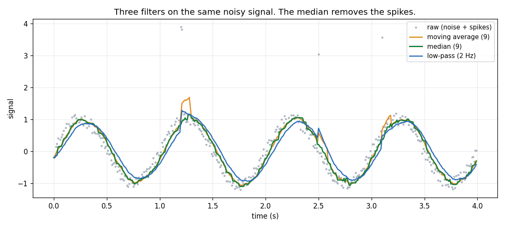
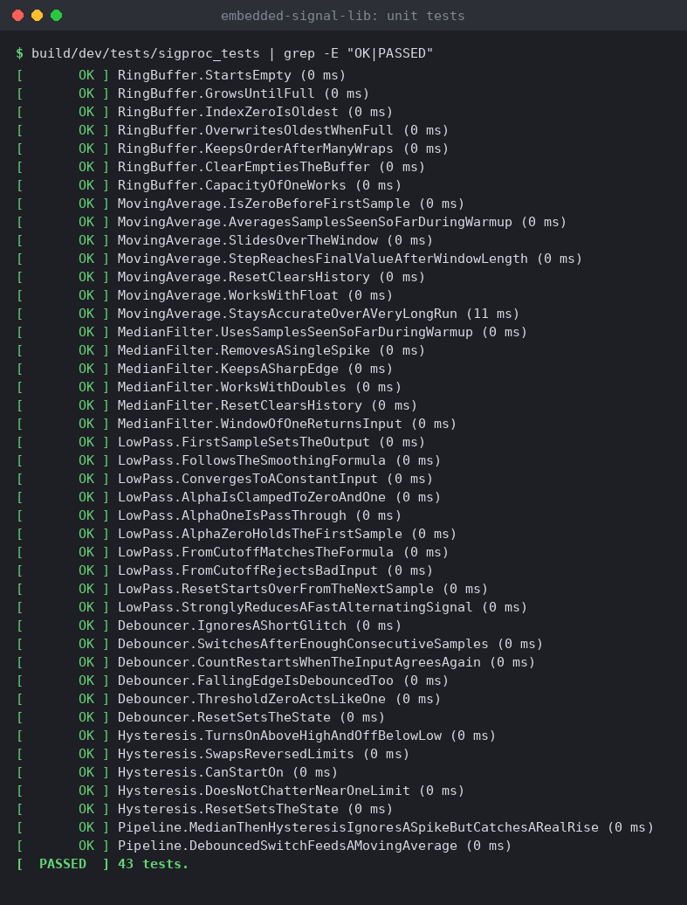
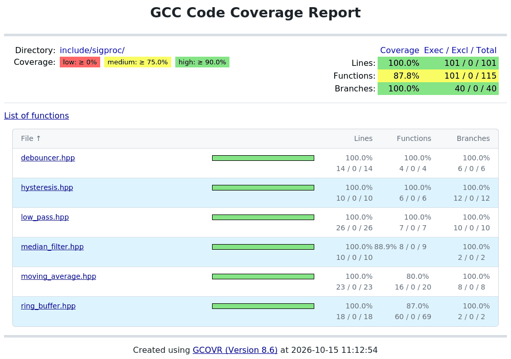

# embedded-signal-lib

[](https://github.com/ravikiranmysore/embedded-signal-lib/actions/workflows/ci.yml)
[](https://codecov.io/gh/ravikiranmysore/embedded-signal-lib)


Small C++17 building blocks for sensor signals. Header-only. No heap. Well tested.



## Why this exists

Sensor readings are noisy. Switches bounce. One bad ADC value can trigger a false alarm. Every embedded project needs the same few blocks to deal with this. This library has them, with tests that run on every push.

## What is inside

| Block | Use it to |
|---|---|
| `RingBuffer<T, N>` | Keep the last N values in fixed memory |
| `MovingAverage<T, N>` | Smooth a signal |
| `MedianFilter<T, N>` | Remove single bad readings and keep sharp edges |
| `LowPass<T>` | Smooth with a cutoff frequency (first-order filter) |
| `Debouncer` | Clean up a bouncing switch input |
| `Hysteresis<T>` | Switch on and off at two levels, so a value near a limit does not chatter |

## Example

```cpp
#include <sigproc/sigproc.hpp>

sigproc::MedianFilter<float, 5> median;
auto lowPass = sigproc::LowPass<float>::fromCutoff(5.0F, 100.0F);  // 5 Hz at 100 Hz sample rate
sigproc::Hysteresis<float> overTemp(80.0F, 90.0F);                 // off below 80, on above 90

bool overTemperature(float adcReading) {
    const float clean = lowPass.update(median.update(adcReading));
    return overTemp.update(clean);
}
```

## Design rules

- Header-only. Add `include/` to your include path and go.
- No heap use. All buffers have a size fixed at compile time.
- No exceptions. Functions are `noexcept`. Bad numeric input is clamped, and each header says how.
- Floating point blocks are templates, so you choose `float` or `double`.
- Written in the spirit of embedded coding standards such as MISRA C++ and AUTOSAR C++14. It is not certified and has not been checked with a MISRA tool.
- Some functions have preconditions, for example `RingBuffer::operator[]` needs a valid index. They are written next to the code.

## Quality checks

Every push runs these in GitHub Actions.

| Check | Tool |
|---|---|
| Build with all warnings as errors | GCC and Clang |
| Unit tests | GoogleTest |
| Memory and undefined behaviour bugs | AddressSanitizer and UBSan |
| Line coverage, fails below 90 percent | gcov and gcovr |
| Static analysis | clang-tidy and cppcheck |
| Code style | clang-format |

## Results

Unit tests, all passing:



Coverage report. Lines and branches are at 100 percent. The function figure is lower because gcovr counts each template instantiation as its own function. It is not untested code.




## Build and test

You need a C++17 compiler, CMake 3.21 or newer and Ninja.

```bash
# Ubuntu or WSL
sudo apt install g++ cmake ninja-build

cmake --preset dev
cmake --build --preset dev
ctest --preset dev
```

GoogleTest is found on the system or downloaded by CMake. You do not install it by hand.

Run the demo and make the plot:

```bash
./build/dev/examples/sigproc_demo > demo.csv
pip install matplotlib
python scripts/plot_demo.py demo.csv docs/demo.png
```

## Using VS Code

1. On Windows, install WSL with Ubuntu (`wsl --install`) and open the folder from WSL. On Linux, open the folder directly.
2. Install the extensions **C/C++**, **CMake Tools** and, on Windows, **WSL**. VS Code will suggest them.
3. Pick the `dev` preset when CMake Tools asks.
4. Click **Build**. Run the tests from the **Testing** panel.

## Measure coverage

```bash
pip install gcovr
cmake --preset coverage
cmake --build --preset coverage
ctest --preset coverage
gcovr --root . --filter include/ --object-directory build/coverage --merge-lines --print-summary
```

`--merge-lines` matters for templates. Without it, gcovr counts every instantiation as separate lines.

### Show the coverage badge

1. Sign in at codecov.io with your GitHub account and add this repository.
2. Copy the upload token from the Codecov page.
3. In the GitHub repo, open **Settings**, then **Secrets and variables**, then **Actions**. Add a secret named `CODECOV_TOKEN`.
4. Re-run the `ci` workflow. The badge at the top fills in after the upload.

Without the token, CI still passes. It just skips the upload.

## Project layout

```
include/sigproc/   the library, one header per block
tests/             GoogleTest unit tests
examples/          demo program that prints CSV
scripts/           plot script for the demo
docs/              demo plot
CMakePresets.json  dev, coverage and asan presets
.github/workflows/ CI pipeline
```

## Limits and ideas

- Fixed windows only. The window size is a template parameter.
- Not yet built or tested with MSVC. The CMake file has MSVC warning flags, but CI uses GCC and Clang.
- Ideas: rate limiter, exponential moving median, fixed-point (integer) versions, and a Python plot of step responses.

## License

MIT. See `LICENSE`.
